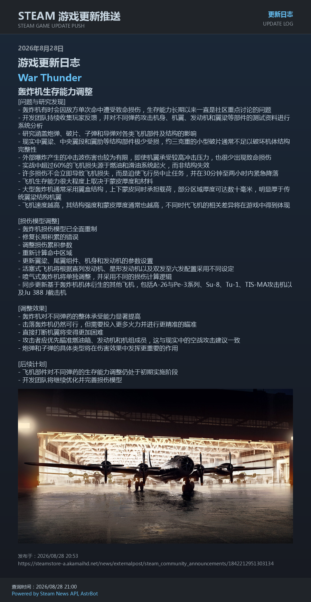
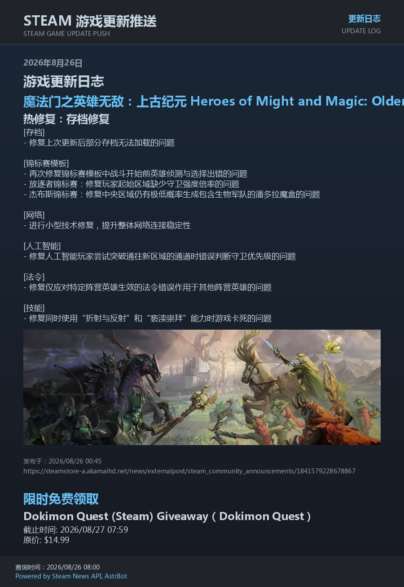
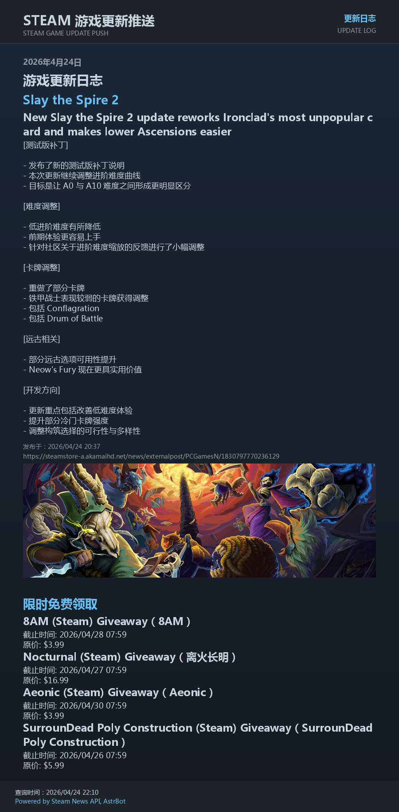

# ✨ Steam 游戏/创意工坊更新推送 | Steam Update Push (AstrBot Plugin)


## ✅ 简介 | Introduction

<table>
  <tr>
    <td width="190" align="center">
      
    </td>
    <td>
      <strong>Steam Update Push</strong><br />
      Steam News · Workshop · Free Games<br />
      <sub>Clear updates, delivered to your AstrBot conversations.</sub>
    </td>
  </tr>
</table>

这是一个为 **AstrBot** 编写的插件：轮询游戏/创意工坊更新并推送（支持多 AppID、创意工坊ID、卡片或文本）

[](https://github.com/DearCrazyLeaf/astrbot_plugin_steam_updates/releases/latest)
[](https://www.gnu.org/licenses/gpl-3.0.txt)
[](https://github.com/DearCrazyLeaf/astrbot_plugin_steam_updates/issues)
[](https://github.com/DearCrazyLeaf/astrbot_plugin_steam_updates/pulls)
[](https://qm.qq.com/q/H3uUCEZKgg)
[](https://github.com/DearCrazyLeaf/astrbot_plugin_steam_updates/stargazers)

> [!IMPORTANT]
> 本插件优先使用 **Steam News API** 获取游戏更新日志；当 API 失败或返回为空时，可启用 Steam Feed 自动回退

## ✅ 功能列表 | Features

> [!NOTE]
> 特别感谢 [@RhoninSeiei](https://github.com/RhoninSeiei) 为本插件提供维护和优化！

- **被动推送**：自动轮询 Steam 更新日志
- **多游戏**：支持多个 AppID 统一推送
- **多平台推送**（[@RhoninSeiei](https://github.com/RhoninSeiei)）：支持使用 UMO 配置多个平台、多个同类型适配器实例、群聊、私聊和其他会话
- **分会话配置**（[@RhoninSeiei](https://github.com/RhoninSeiei)）：支持分群聊/会话单独配置订阅内容和推送
- **手动查询**：群内指令触发即时查询
- **LLM整理**：可选用大模型同时翻译公告标题并整理正文，不增加额外模型请求
- **逐条公告配图**（[@RhoninSeiei](https://github.com/RhoninSeiei)）：优先显示每条公告正文中的首张有效图片，失败时自动尝试后续候选并回退游戏头图
- **自动过滤已标记的外部文章**：排除 News API 标记为 `is_external_url` 的新闻，以及 Feed 链接路径含 `externalpost` 的文章
- **卡片/文本**：两种输出模式可选
- **无更新静默**：当天无更新不推送
- **限时免费领取活动**（[@RhoninSeiei](https://github.com/RhoninSeiei)）：支持将当前仍可领取的 Steam 游戏作为独立分区“限时免费领取”并入游戏更新推送
- **创意工坊订阅监控**：支持轮询 Workshop PublishedFileID，发现更新时间变化后推送，支持查询非公开创意工坊内容








## 🔤 内置字体与许可 | Bundled Fonts and Licensing

### 为了适配 AstrBot 插件的大小限制，本插件使用专用的精简字体文件

```
  > font/SteamUpdatesCJK-Regular.ttf：常规字重
  > font/SteamUpdatesCJK-Bold.ttf：粗体字重
```

- 这两个字体是基于 **Source Han Sans CN Regular** 和 **Source Han Sans CN Bold，Version 2.005** 构建的子集字体，保留插件界面所需的常用简体中文、拉丁字符、CJK 标点、全角字符和日文假名。由于 `Source` 是上游许可证中的保留字体名称，衍生字体已重命名为 `SteamUpdatesCJK`

- 原始字体版权归 Adobe（2014-2025）所有，字体软件及其衍生字体依照 **SIL Open Font License 1.1** 发布。本插件随 `font/` 目录一并提供构建说明和完整许可证文本：

```
  > font/FONT-NOTICE.txt：字体来源、子集内容和重命名说明
  > font/OFL-1.1.txt：SIL Open Font 许可证 1.1
```

- 字体文件可以随本插件进行打包、嵌入和再分发，但字体软件本身必须继续遵循 OFL 1.1，且不得单独出售。插件代码本身仍遵循本项目的 GPL-3.0 许可；字体许可与插件代码许可相互独立

## 📦 安装 | Installation

将插件目录放入：
```
AstrBot/data/plugins/astrbot_plugin_steam_updates
```

重启 AstrBot 后即可在 WebUI 中看到插件

## ⚙️ 配置 | Configuration

插件使用 `_conf_schema.json` 定义配置，入口：
```
AstrBot WebUI -> 插件 -> 插件配置
```

### 🔧 核心配置

| 配置项 | 说明 |
|--------|------|
| enable_push | 是否启用插件 |
| steam_web_api_key | Steam Web API Key（可选） |
| enable_feed_fallback | 是否启用 Steam Feed 回退 |
| feed_timeout_sec | Feed 回退超时秒数 |
| game_query_concurrency | 游戏新闻最大并发查询数，默认 `4`，范围 `1-8`；后台轮询和手动查询共享该上限 |
| appdetails_retry_attempts | AppID 名称查询最大尝试次数，默认 `3`，范围 `1-5`；暂时性网络失败时每次间隔 2 秒重试 |
| free_games_enable | 是否启用限时免费领取活动 |
| free_games_manual_only_when_no_news | 手动查询在没有普通游戏更新时，是否仅返回“限时免费领取”分区 |
| display_timezone | 免费领取截止时间显示时区；留空跟随容器系统时区，填写 IANA 时区名时按 UTC 活动源时间转换显示 |
| proxy_mode | 代理模式：`off` / `system` / `custom` |
| proxy_url | 自定义代理地址（仅 `custom` 生效） |
| steam_appids | AppID 列表（如 `730`） |
| workshop_enable | 是否启用创意工坊订阅监控 |
| workshop_item_ids | 创意工坊订阅ID列表（PublishedFileID） |
| workshop_api_base | 创意工坊API基础地址 |
| workshop_timeout_sec | 创意工坊请求超时秒数 |
| workshop_push_on_first_seen | 首次发现时是否立即推送（默认仅记录基线） |
| steam_lang | 语言（如 `schinese` / `english`） |
| poll_interval_sec | 轮询间隔（秒，从起始时间开始计时） |
| poll_start_time | 轮询起始时间（HH:MM） |
| notify_umos | 完整 UMO 列表；推荐字段，支持多个平台实例与全部 AstrBot 合法消息类型 |
| notify_group_ids | 推送群号列表 |
| platform_id | 平台 ID（可选，如 chatbot2） |
| message_mode | `card` 或 `text` |
| manual_query_game_command | 游戏更新手动查询指令（可配置多个） |
| manual_query_workshop_command | 创意工坊手动查询指令（可配置多个） |
| content_process_mode | 内容处理方式：`plugin` / `llm` |
| llm_provider_id | LLM 提供商ID（可选，WebUI下拉选择） |
| llm_timeout_sec | LLM 请求超时秒数（默认 `30`，范围 `5-30`，超时后回退到插件内置处理） |
| llm_input_max_chars | 单个游戏传给 LLM 的最大输入字数（默认 `8000`，范围 `1000-20000`；超出部分截断以控制模型输入量） |
| llm_round_timeout_sec | 每轮 LLM 内容处理的总时间预算（默认 `90` 秒，范围 `30-300`；耗尽后剩余公告保留原文并标注） |
| llm_prompt | LLM 提示词（仅 llm 模式生效） |
| max_days | 每个游戏最多展示最近 N 天更新 |
| content_max_chars | 单条公告正文最大字数 |
| image_max_per_item | 每条更新最多渲染图片数（默认 1） |
| image_max_height | 游戏头图、免费活动和创意工坊图片的最大高度；普通公告原图按比例和整卡像素预算处理 |
| enable_app_headers | 是否启用游戏头图渲染 |
| image_download_timeout_sec | 内容图片下载超时秒数 |
| header_download_timeout_sec | 游戏头图下载超时秒数 |
| prefetch_image_concurrency | 内容图片预取并发数 |
| prefetch_header_concurrency | 头图预取并发数 |
| failed_download_cooldown_sec | 下载失败冷却时间（秒） |
| debug_log | 调试日志（仅控制台输出） |

---

### 🧪 调试日志

- 打开 `debug_log` 后，插件会输出结构化日志到 AstrBot 控制台
- 主要阶段：`poll`、`fetch`、`fetch_api`、`fetch_feed`、`manual`、`manual_cmd`、`send`、`push`、`ping`
- 不会生成额外日志文件，便于在线排查

---

### 🌐 代理说明

- `proxy_mode=system`：读取 AstrBot 进程环境变量（如 `HTTP_PROXY` / `HTTPS_PROXY`）
- `proxy_mode=custom`：使用 `proxy_url` 强制指定代理（推荐，最可控）
- `proxy_mode=off`：不使用代理，直连请求

建议：
- 若创意工坊查询出现 `ConnectTimeout/ReadTimeout`，优先改为 `custom` 并设置 `proxy_url`（例如 `http://127.0.0.1:7890`）
- 创意工坊不仅依赖 `api.steampowered.com`，还依赖 `steamcommunity.com`
- 仅代理 API 而不代理社区域名时，常见现象是：游戏更新可用、创意工坊失败

## 🗂️ AppID 名称映射 | AppID Name Map

> [!IMPORTANT]
> 为了适应`Astrbot`的市场要求：从1.3.6版本开始，
> 插件根目录内的 `appid_map.json` 只负责初次分发时读取默认映射，随后会写入新文件 `appid_name_map.json` 作为插件数据目录中的真实运行依赖，请注意备份旧 `appid_map.json` ！

#### ⚠️ 从 `V1.3.6` 版本开始，插件目录结构发生改变！

- 插件首次查询并成功获取名称后，会将映射保存到插件数据目录中的 `appid_name_map.json`
- 从旧版本覆盖升级时，插件目录中的 `appid_map.json` 可能被新版文件替换，如果其中包含自定义映射或运行时缓存，请在升级前备份
- 新版不会自动迁移旧文件中的映射，缺失的名称会在后续查询时重新联网获取并保存

示例：
```json
{
  "730": {
    "schinese": "反恐精英2",
    "english": "Counter-Strike 2",
    "japanese": "カウンターストライク 2"
  }
}
```

## 🧭 网络代理建议 | Network Proxy (Clash)

部分地区访问 Steam 相关服务可能不稳定，推荐使用 Clash **混合模式**并代理下列域名：

```yaml
mixin:
  mode: rule

  proxy-groups:
    - name: STEAM-UPDATES
      type: select
      proxies:
        - HK   # ← 改成你的节点
        - DIRECT

  rules:
    # Steam 更新插件核心域名（建议代理）
    - DOMAIN,api.steampowered.com,STEAM-UPDATES
    - DOMAIN,store.steampowered.com,STEAM-UPDATES
    - DOMAIN-SUFFIX,steamcommunity.com,STEAM-UPDATES
    - DOMAIN-SUFFIX,steampowered.com,STEAM-UPDATES

    # 资源域名（建议同样走代理，减少超时）
    - DOMAIN-SUFFIX,steamstatic.com,STEAM-UPDATES
    - DOMAIN-SUFFIX,steamusercontent.com,STEAM-UPDATES
    - DOMAIN-SUFFIX,akamaihd.net,STEAM-UPDATES

    # 其余流量直连
    - MATCH,DIRECT
```

## 📌 使用说明 | Usage

### 📣 自动推送
- 开启 `enable_push` 后，插件会自动轮询并向 `notify_umos` 与旧 `notify_group_ids` 的合并目标发送更新，新字段先处理，旧字段随后处理；规范 UMO 相同的目标只发送一次

- 若同时开启 `workshop_enable` 并配置 `workshop_item_ids`，会在同一轮询中检测创意工坊条目更新时间并合并推送

- 游戏公告会按正文顺序提取图片候选并显示首张可用图片；图片保持原始比例，不裁剪、不拉伸，窄图保持原始尺寸并水平居中，全部候选失败时回退游戏头图

- 卡片图片在本地生成或构造失败时会回退为文字；如果图片发送请求已经发出但平台返回非确认结果或发生异常，插件会将结果视为未知，不在同一轮补发文字，并记录该目标的新闻状态以避免自动重推。此策略优先避免重复，未知结果可能意味着消息未送达，需要检查目标会话后再决定是否手动处理

- 使用 `llm` 内容处理模式时，每个游戏的一次模型请求会按公告 ID 分别返回标题和整理后的正文；公告不会合并，原公告的 GID、发布时间、链接和图片均保留。模型输出会校验 ID、重复项和缺失项，异常项单独回退原文

- LLM 输入会省略发布时间和链接，并受 `llm_input_max_chars` 限制；符合新逐条协议且所有公告均通过校验的成功结果会在插件数据目录缓存最多 24 小时（最多 256 条），旧版合并公告格式缓存不会复用，部分失败结果不会缓存

- 单条 LLM 处理失败时只对该公告保留原文并标注失败原因；单个游戏查询失败会显示“Steam 查询失败，暂时无法获取公告”，与查询成功但没有更新区分。自动推送中的查询失败提示按目标冷却 6 小时，失败 AppID 不会被写入已处理状态，后续轮询仍会重试
- 插件不会自动重试 LLM 请求；请求仍保持串行，单请求超时上限为 30 秒，每轮另有 `llm_round_timeout_sec` 总预算，避免多游戏处理无限延长。预算耗尽后剩余公告保留原文并标注，不再发起 LLM 请求

- 若开启 `free_games_enable`，新的免费领取活动会在首次发现时主动推送一次；活动仍在领取期内时，只要同一轮存在普通游戏更新推送，就会作为独立分区“限时免费领取”附在游戏更新后面

- 免费领取活动正文现在仅保留“截止时间”和“原价”

- 免费领取活动在文本模式和卡片模式下均不会额外显示发布时间与链接

- 即使某一轮免费领取活动正文仍混入旧版“领取方式”或“活动链接”，渲染阶段也会自动裁剪，只保留“截止时间”和“原价”

- `display_timezone` 留空时跟随容器系统时区；填写 IANA 时区名时，活动源时间会先按 UTC 解释，再转换为目标时区显示截止时间

- 免费领取活动数据来自 GamerPower 公开接口：`https://www.gamerpower.com/api/giveaways?platform=steam&type=game`

- 该功能已经经过线上轮询与手动查询验证，可通过 `free_games_enable` 独立开启或关闭

---

### 🌐 UMO 推送目标（[@RhoninSeiei](https://github.com/RhoninSeiei)）

- UMO 格式为 `platform_id:message_type:session_id`。可在目标会话发送 `/sid` 获取完整值。

- 当前 AstrBot 常见消息类型包括 `GroupMessage`、`FriendMessage` 和 `OtherMessage`。插件使用 AstrBot 的 `MessageSession` 校验 UMO，因此接受当前运行版本认可的全部合法 UMO，后续版本增加的合法消息类型也会随运行版本生效。

- 多个同类型适配器必须填写各自的平台实例 ID，例如：

```text
  > qq-account-1:GroupMessage:123456
  > qq-account-2:GroupMessage:123456
  > telegram-main:FriendMessage:987654
  > lark-main:OtherMessage:chat:thread:42
```

- `notify_umos` 与 `notify_group_ids` 可以同时使用。`notify_umos` 中的目标优先；新旧目标规范化为 UMO 后保序去重。旧字段中的纯群号使用 `platform_id` 转换为 `GroupMessage` UMO，旧字段中已有的完整 UMO 继续按完整 UMO 解析。

- 主动消息能否发送取决于对应平台适配器的能力。AstrBot 的 QQ 官方 API 适配器不支持该主动发送接口。单个目标失败时，其余目标仍会继续发送。卡片图片失败时，文本只补发给该图片失败目标。全部目标均发送失败时，插件保留本轮轮询状态，等待后续再次发送。

- 手动查询支持已配置的群聊和私聊会话；命令只在当前 UMO 存在有效订阅时执行。主动私聊推送是否可用仍取决于对应平台适配器。

---

### 🎯 分会话订阅（[@RhoninSeiei](https://github.com/RhoninSeiei)）

为不同群聊/会话设置各自的游戏、创意工坊和免费领取推送，也可以单独选择图片或文字消息；不同平台实例中的同一群号会作为不同会话处理

### ⚙️ 配置方式

在插件配置中打开“按群聊/会话设置推送 → 群聊/会话列表”，添加一项设置，并填写：

- `/sid` 返回的完整会话标识

- 要订阅的 Steam 游戏 AppID 和创意工坊条目 ID

- 是否接收限时免费领取通知，以及消息显示方式

> [!NOTE]
> 群聊、私聊及其他 AstrBot 支持的会话类型都可以配置，私聊用户可以查看订阅和执行手动查询，但不能修改订阅设置；私聊目标的配置由 AstrBot 管理员负责

---

### 📌 推送规则

- **没有添加任何会话设置时**，插件沿用原来的全局推送目标和订阅内容

- **添加了至少一项会话设置后**，插件只向列表中有效且已开启的会话推送；不会再把全局目标或全局订阅补充进来，列表之外的会话也不会收到推送

- 每项设置中的游戏和创意工坊列表会替代全局对应列表；留空表示该会话不订阅这一类更新

- 创意工坊推送仍需要开启全局创意工坊开关；免费领取的全局开关是总开关，关闭后任何会话都不会收到免费领取通知

- 免费领取通知和消息显示方式默认跟随全局设置，也可以单独为某个会话选择开启、关闭或指定显示方式

- 暂停只会停止该会话的自动推送，设置仍会保留；清空订阅不会让该会话重新跟随全局列表

- 删除某会话的设置后，如果列表中还有其他设置，该会话就不会收到推送；删除最后一项后，插件会恢复全局推送，该会话是否收到消息取决于全局推送目标。若只是想暂时停止推送，请使用“暂停”

- 同一个会话标识只添加一次；如果重复，插件只使用第一项有效设置，后续重复项会忽略，请在配置页面检查并删除重复项

- 新订阅的游戏、工坊或免费领取内容会在首次成功查询时记录当前内容，不会补推此前的更新；需要时可使用手动查询查看当前内容

- 推送状态按会话分别记录；明确发送失败时会继续尝试，发送成功或结果不确定时不会自动重复推送

> [!NOTE]
> 首次在当前会话使用管理指令时，插件会创建该会话的独立设置：
> 游戏和创意工坊列表会按当前会话已有的订阅内容初始化；免费领取通知和消息显示方式默认跟随全局设置

---

### 💬 管理当前会话

在当前群聊或私聊中发送以下指令：

| 指令 | 说明 |
| --- | --- |
| `/STEAM订阅 列表` | 查看当前会话的订阅；也可以直接发送 `/STEAM订阅` |
| `/STEAM订阅 添加 游戏 730 570` | 添加一个或多个游戏 AppID |
| `/STEAM订阅 删除 游戏 730` | 取消指定游戏；全部删除后，该会话仍保留独立设置 |
| `/STEAM订阅 添加 创意工坊 123456789` | 添加创意工坊条目；删除时将“添加”替换为“删除” |
| `/STEAM订阅 免费领取 开启` | 设置免费领取通知，可选“开启”“关闭”或“继承” |
| `/STEAM订阅 模式 图片` | 设置消息显示方式，可选“图片”“文字”或“继承” |
| `/STEAM订阅 暂停` | 暂停当前会话的自动推送，仍可手动查询 |
| `/STEAM订阅 恢复` | 恢复自动推送，不补发暂停期间的更新 |
| `/STEAM订阅 恢复全局 确认` | 删除当前会话的独立设置；其他会话仍有设置时，当前会话不会收到推送 |

**英文指令 `/steam_sub` 与中文指令用法相同，现有 `STEAM更新`、`创意工坊更新` 和自定义查询指令也会按当前会话的订阅内容查询**

---

### 🛡️ 权限与跨会话管理

- 所有人都可以查看当前会话的订阅

- 私聊用户可以查看当前私聊的订阅，也可以在该私聊已配置时执行手动查询；修改私聊订阅仅限 AstrBot 管理员

- 群聊设置只能由 AstrBot 管理员，或平台确认的本群群主、管理员修改；群管理员不能管理其他群聊

- 跨会话管理仅限 AstrBot 管理员，可查看全部订阅，或指定完整会话标识操作：

```text
/STEAM全局订阅 "qq-main:GroupMessage:123456" 添加 游戏 730
/STEAM全局订阅 「bot with space:GroupMessage:123456」 暂停
```

**英文指令为 `/steam_sub_global` ，会话标识中含空格时，请用引号或 `「」` 包住，每个会话的游戏和创意工坊各最多添加 100 个 ID**

---

### 🔄 配置保存与升级

- 指令和配置页面会修改同一份设置；指令修改成功后，请刷新已打开的配置页面再继续编辑，避免旧页面覆盖刚保存的内容

- 首次升级分会话订阅时，插件在数据目录备份旧推送状态；若要回退旧版本，请先停止插件，再恢复对应备份，避免新旧版本使用不同的推送记录

---

### 💬 手动查询

群内发送任一配置指令即可触发，例如：

```
  > STEAM更新
  > steam更新
  > cs2更新
```

- 当没有普通游戏更新但存在仍可领取的免费游戏时，`free_games_manual_only_when_no_news` 默认为开启，此时仅返回“限时免费领取”分区

- 如果将 `free_games_manual_only_when_no_news` 设为关闭，当天没有普通游戏更新时，命令会回退展示较早的游戏更新，并在该回退结果后附上“限时免费领取”分区

- 如果未配置游戏 AppID 但仍启用 `free_games_enable`，手动查询会继续返回当前有效的“限时免费领取”分区

- 免费领取活动标题优先显示接口原始名称；如果可解析到 Steam 官方中文名，则显示为 `原始标题（官方中文名）`

---

### 🛰️ 平台捕获

当不清楚当前会话的完整 UMO 时，可在群内发送：

```
  > steam_update_ping
```

> [!NOTE]
> `steam_update_ping` 只为旧纯群号兼容模式捕获平台实例 ID 和 aiocqhttp bot
> 完整 UMO 使用自身的平台实例 ID，无需依赖该命令

## 🧪 开发验证与贡献指南 | Development and Contribution Guide

### 🛠️ 准备开发环境

插件使用 `Python 3.10+`，CI 会在 `Python 3.10` 和 `Python 3.12` 上运行单元测试，提交代码前建议至少在其中一个版本完成验证

在插件目录中创建并启用虚拟环境，再安装开发和运行所需依赖：

```powershell
python -m venv .venv
.venv\Scripts\Activate.ps1
python -m pip install -r requirements.txt
```

如果使用 macOS 或 Linux，将激活命令替换为：

```bash
source .venv/bin/activate
```

---

### ✅ 运行单元测试

在插件根目录执行：

```bash
python -m unittest discover -s tests -v
```

- 测试覆盖订阅配置与权限、推送路由和状态、失败重试、消息构建等核心逻辑

- 测试使用临时目录和替代发送端，不会向真实群聊或私聊发送消息

- 新增或修复功能时，请同时补充对应的回归测试

---

### 🔌 验证 AstrBot 集成

`tests/smoke_core.py` 不属于上述单元测试，也不使用测试桩替代 AstrBot，请在已安装与插件兼容版本 AstrBot 的隔离环境中运行：

```bash
python tests/smoke_core.py
```

> [!NOTE]
> 该脚本验证插件能否导入真实 AstrBot 接口、订阅指令参数解析，以及原生配置模板的读取和保存回读，它不连接真实平台，也不验证实际消息投递

---

### 🚀 提交前检查

- 确认单元测试全部通过；涉及 AstrBot 指令或配置结构时，再运行集成烟雾测试

- 检查新增配置字段是否同步更新 `_conf_schema.json`、默认值和用户文档

- 为修复的问题添加能复现旧行为的回归测试

- 不要在测试中使用真实平台发送端、个人凭据或生产数据

- Pull Request 的 GitHub Actions 会在 Python 3.10 和 3.12 上运行单元测试；烟雾测试需由贡献者在隔离 AstrBot 环境中单独执行

## ❤️ 贡献者 | Contributors

<a href="https://github.com/DearCrazyLeaf/astrbot_plugin_steam_updates/graphs/contributors">
  
</a>


## 📜 许可证 | License

[](https://www.gnu.org/licenses/gpl-3.0.txt)

---

> Made for AstrBot ❤️
